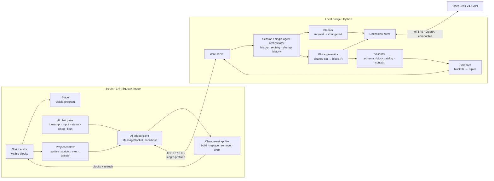

# Scratch 1.4 AI Harness — Feasibility & Architecture

**Status:** implemented MVP; architecture notes for the connection layer updated 2026-11-12  
**Vision:** a modern AI coding harness inside Scratch 1.4 — chat, plan, change the project, run it, iterate  
**Target:** Scratch 1.4 (Squeak/Smalltalk), Windows first  
**Model:** DeepSeek-V4.1-Flash via the OpenCode Go gateway (`opencode-go` profile), with an in-image switch to HY4-Flash-Free from the Usage page; profiles are configurable through `bridge/harness.ini`

---

## 1. Executive summary

**Verdict: feasible for a focused MVP. The hard part is the Squeak UI and state management, not the AI.**

This is not just “generate a script from a prompt.” The goal is to reproduce the feel of modern agentic coding inside Scratch 1.4:

- The user chats with an AI assistant in a side pane.
- The assistant reads the current project, plans a change, and applies real Scratch blocks to the visible project.
- The assistant replies with a short coding-harness-style summary: what changed, why, and what to try next.
- The user clicks the green flag, watches the program, and asks for changes.
- The assistant sees the current project state and the conversation history, then edits its previous work.

The recommended design:

- A **docked AI chat pane** on the right side of Scratch, with a collapsible toggle. A tab is the lower-risk fallback.
- A **local Python bridge** that owns the DeepSeek API key, conversation/session state, prompting, block IR generation, validation, and change-set compilation.
- A **block-native pipeline**: the LLM generates Scratch block IR directly. No Python intermediate.
- **Change sets**, not just new scripts: add, replace, and delete AI-owned scripts; create variables; apply atomically; undo.
- **Native tuple serialization** for the image: block IR → Scratch tuples → Smalltalk literal → `BlockMorph`.
- **A single agent loop** with deterministic stages. No multi-agent orchestration is required.

The result is a Scratch project that behaves like a small codebase: the AI can inspect it, edit it, explain the diff, and iterate with the user.

---

## 2. The experience

### First turn

```text
You: Make the cat draw a square when I click the green flag.

AI:  I added a green-flag script to Sprite1.

     • clear the pen
     • put the pen down
     • repeat 4 times: move 100 steps, turn right 90°
     • put the pen up

     Click the green flag to try it. If you want it bigger,
     slower, or a different shape, tell me.
```

The blocks are already in the visible project. The AI pane shows a **Changes** card:

```text
Added script "draw_square" to Sprite1 · 5 blocks
[Undo] [Show blocks] [Run]
```

### Run

The user clicks the green flag (or the **Run** button in the AI pane). The cat draws a square.

### Second turn

```text
You: Make it bigger and say "Done!" at the end.

AI:  I updated the square script.

     • move 100 → 200 steps
     • added say "Done!"

     Click the green flag to see the new version.
```

The old AI-created script is replaced in place, not duplicated. The user runs it again.

### What makes this a harness rather than a generator

| Modern AI coding harness | Scratch AI harness |
|---|---|
| Chat with a coding agent | AI chat pane in Scratch |
| Repository / files | Scratch project: sprites, scripts, variables, assets |
| Read files | Read project context and block tuples |
| Plan a change | Produce a change set |
| Edit files | Replace / add / delete block scripts |
| Compiler / linter | Block-catalog validation |
| Run tests | Optional run + telemetry / stage screenshot |
| Git diff | Change summary / block diff |
| Undo / revert | Undo the last change set |
| Iterate | Run, observe, describe the problem, repeat |

The educational value is the loop itself: **describe → plan → change → run → observe → refine**. That is modern agentic coding, made visible with blocks.

---

## 3. What Scratch 1.4 gives us

Scratch 1.4 is a Squeak Smalltalk image based on a modified Squeak 2.8. The source already contains the hooks needed for the harness.

### 3.1 Verified hooks

| Need | Existing hook |
|---|---|
| Build a block from data | `ScriptableScratchMorph class >> blockFromTuple:receiver:` |
| Build a block stack | `ScriptableScratchMorph class >> stackFromTupleList:receiver:` |
| Insert a stack into a sprite | `ScriptableScratchMorph >> addStack:` |
| Refresh the visible editor | `ScriptableScratchMorph >> viewBlocksAndScripts` |
| Run the project | `ScratchFrameMorph >> shoutGo` |
| Stop everything | `ScratchFrameMorph >> stopAll` |
| Read variables | `ScriptableScratchMorph >> getVar:`, `varNames` |
| Create a variable | `ScriptableScratchMorph >> addVariable:` |
| Capture the stage | `ScratchStageMorph >> stageShotSized:`, `Form >> writePNGFileNamed:` |
| Add a pane / tab | `ScratchFrameMorph >> createBasicPanes`, `fixLayout`; `ScratchScriptEditorMorph >> createTabPane` |
| Local TCP with framing | `MessageSocket` (4-byte length prefix) |
| Readable block dump | `ScratchPrinter` |

All of these are present in the 1.4 source image (`src/Scratch.changes`).

### 3.2 The native block format

`BlockMorph >> tupleSequence` turns a script into an array of tuples. `blockFromTuple:receiver:` and `stackFromTupleList:receiver:` do the reverse. The `.sb` project format stores scripts in this form.

For example:

```smalltalk
#(
  #(EventHatMorph 'Scratch-StartClicked')
  #(clearPenTrails)
  #(putPenDown)
  #(doRepeat 4 #(
      #(forward: 100)
      #(turnRight: 90)))
  #(putPenUp)
)
```

This is the exact shape the image builder expects. The LLM does not write this; the bridge compiles block IR into it.

### 3.3 Run and observe are possible

- Green flag: `ScratchFrameMorph >> shoutGo` broadcasts `Scratch-StartClicked`.
- Stop: `ScratchFrameMorph >> stopAll`.
- Telemetry: variables, sprite positions, directions, costumes, visibility.
- Screenshot: `ScratchStageMorph >> stageShotSized:` returns a `Form`; `Form >> writePNGFileNamed:` writes a PNG. The stage can therefore be captured for the chat or for vision-capable models.

This makes an optional “run and inspect” loop feasible, which is the closest Scratch equivalent to tests in a coding harness.

---

## 4. Architecture

### 4.1 Component diagram



ASCII fallback:

```text
┌──────────────────────────── Scratch 1.4 (Squeak) ─────────────────────────────┐
│                                                                              │
│  ┌────────────┐   ┌──────────────────────┐   ┌────────────────────────────┐  │
│  │ Stage      │   │ Script editor        │   │ AI chat pane               │  │
│  │ (visible)  │   │ (visible blocks)     │   │ transcript · input ·       │  │
│  │            │   │                      │   │ status · Undo · Run        │  │
│  └────────────┘   └──────────┬───────────┘   └─────────────┬──────────────┘  │
│                              │                             │                 │
│                   ┌──────────▼───────────┐     ┌───────────▼──────────────┐  │
│                   │ Change-set applier   │     │ AI bridge client         │  │
│                   │ build · replace ·    │     │ session · messages       │  │
│                   │ remove · undo        │     │ run · telemetry          │  │
│                   └──────────┬───────────┘     └───────────┬──────────────┘  │
│                              │                             │                 │
│                   ┌──────────▼─────────────────────────────▼──────────────┐  │
│                   │ AIProjectContext: sprites, scripts, vars, assets      │  │
│                   └──────────────────────────┬───────────────────────────┘  │
└──────────────────────────────────────────────┼──────────────────────────────┘
                                               │ TCP localhost
┌──────────────────────────────────────────────▼──────────────────────────────┐
│                         Local bridge (Python)                               │
│                                                                             │
│  Wire server ──▶ Session / agent orchestrator ──▶ DeepSeek client           │
│       ▲              │                                                      │
│       │              ├─ Observe: project + chat history + registry          │
│       │              ├─ Plan: change set                                    │
│       │              ├─ Generate: block IR per changed script               │
│       │              ├─ Validate: schema + block catalog + context          │
│       │              ├─ Compile: block IR → Scratch tuples                  │
│       │              └─ Report: chat summary + diff                         │
│       └──────────────────── result/status ◀─────────────────────────────────┘
└─────────────────────────────────────────────────────────────────────────────┘
```

### 4.2 Components

**Scratch side (Squeak):**

- `AIHarnessPaneMorph` — chat transcript, prompt input, status, changes card, Undo, Run/Stop, Show blocks.
- `AIBridgeClient` — TCP connection, request IDs, queue, reconnect, heartbeat.
- `AIProjectContext` — sprites, variables, lists, costumes, sounds, current target, existing scripts as tuples/hashes.
- `AIChangeSetApplier` — validates a change set, builds all new blocks offscreen, applies add/replace/delete atomically, updates the registry, refreshes the editor, and stores undo data.
- `AIRunController` — optional green-flag run, timeout, stop, variable/sprite telemetry, stage screenshot.
- Layout changes to `ScratchFrameMorph` to add/collapse the AI pane; a tab in `ScratchScriptEditorMorph` is the fallback.

**Bridge side (Python):**

- Wire server — asyncio TCP server with 4-byte length framing.
- Session / agent orchestrator — conversation state, script registry, change history, request state machine.
- Planner — natural-language request + context → plan / change set.
- Block generator — plan item → block IR.
- Validator — JSON schema, block catalog, argument types, targets, variables/assets.
- Compiler — block IR → Scratch tuples.
- Smalltalk emitter — tuples → restricted Smalltalk literal.
- Model provider — any OpenAI-compatible endpoint behind `harness.providers`
  (OpenCode Go, DeepSeek direct, local Ollama, mock): JSON chat completions,
  classified errors, bounded retries/backoff, per-attempt timeout, usage and
  latency accounting. Profiles come from `config.py` + `harness.ini`.
- Observability — `obs.py`: one redaction rule for every log line, a structured
  bridge log, and the `#info` status payload behind `bridge-status`.
- Budget, cancel, replay — prompt/context trimming with markers, cooperative
  `#cancel`, and record/replay/cache providers for deterministic development.

**Contract:**

- Block IR schema (versioned).
- Block catalog dumped from the running image.
- Change-set schema.
- Tuple IR / Smalltalk literal (transport only).

### 4.3 The loop

1. User sends a message.
2. Scratch sends the prompt, chat history, project context, and AI script registry to the bridge.
3. The agent observes: what exists, what it created before, what the user changed manually.
4. The agent plans a **change set**: add/replace/delete scripts, create variables.
5. The generator produces block IR for the changed scripts.
6. The validator checks the IR against the block catalog and project context.
7. The compiler converts it to tuples; the bridge sends an atomic apply request.
8. The image builds the blocks, applies the change set, updates the registry, and refreshes the editor.
9. The bridge sends a chat summary + change diff.
10. The user clicks the green flag (or Run), observes, and sends the next request.
11. The loop repeats with the updated project state.

### 4.4 Wire protocol

- TCP on `127.0.0.1` only.
- 4-byte big-endian length + payload, compatible with `MessageSocket`.
- Payload: restricted ASCII Smalltalk literal arrays, not JSON.
- Shared token in the handshake.
- Request IDs to discard stale responses.
- Max payload ~200 KB; context is summarized: scripts are described by label,
  hat, block count and a stable content hash, not full bodies.
- Every request carries a fresh context snapshot, so undo and manual edits are
  reconciled without extra messages.

Example messages:

```smalltalk
#(hello 'token' 'ScratchAI/1')
#(request 17 #('Make the square bigger and say Done!') 'Sprite1' #(
    #('Sprite1' #(
        #('Stage' true #() #() #('background1') #('pop') #())
        #('Sprite1' false #() #() #('costume1' 'costume2') #('meow') #(
            #('ai-1' 'draw_square' 'EventHatMorph' 6 '20692024' true false)
            #('user-123' 'original EventHatMorph' 'EventHatMorph' 5 '675435548' false false))))))
#(status 17 'reading project')
#(status 17 'planning change')
#(apply 17 #(
    #(replace 'ai-1' 'Sprite1' #( ...new tuple... ) 'draw_square')
    #(add 'ai-2' 'Sprite1' #( ...new tuple... ) 'draw_hexagon')
    #(createVariable 'score' #global 0)))
#(applied 17 'Updated the square script; added say Done!')
#(error 17 'unknown block: move_to')
```

Context sprite entry: `name isStage variables lists costumes sounds scripts`.
Context script entry: `id label hat blockCount hash owned userEdited` with an
optional eighth element: the script's native tuple sequence for AI-owned
scripts. It is never printed with the project summary; it only feeds lazy
`load_sprite` detail.
`owned=false` marks user-created scripts; the validator treats them as
read-only. The fifth element of `#add`/`#replace` is the script label, persisted
by the image so future context is meaningful.

The image never executes generated Smalltalk. It parses a restricted literal, validates selectors, and calls fixed builder methods.

### 4.5 Why this split

- The **LLM never sees Smalltalk**. It sees block IR and a simplified block catalog.
  With `generator = dsl` it never emits JSON either: it writes a checked Python
  subset that the bridge transpiles deterministically (`PY_DSL_SCOPE.md`); the
  JSON contract remains the default and an accepted fallback.
- The **bridge never executes generated code**. It parses, validates, and compiles data.
- The **image never executes arbitrary code**. It applies a validated change set.
- The **visible result is first-class Scratch code**: editable, saveable, runnable blocks.

### 4.6 Headless dev mode

The dev image is configurable from `scratch/base/harness.ini`:

- `devMode=on` installs a dialog policy before anything can prompt:
  `DialogBoxMorph`, `FillInTheBlank`, `Object`/`PopUpMenu` informs and confirms,
  `Debugger` and `StandardFileStream>>newFileNamed:` all log to
  `dev_errors.log` and return safe defaults. Original methods are kept as
  `devOriginal*`; `devMode=off` restores them.
- `project=` + `autoOpen=on` opens a Scratch `.sb` by absolute path on launch;
  `project open/save` are also control commands. `writeScratchProjectOn:` is the
  serializer (`ScratchV02` + `ObjStream`). A text sidecar `<project>.sb.meta`
  records AI script ids/labels/hashes; on open the registry is rebuilt by content
  hash, so ownership survives the round-trip. Undo is reset.
- `autoSnapshot=on` snapshots in place every N control commands; `startUp`
  probes port 8767 first so a snapshot does not duplicate the server.
- `tools/watch_st.py` reloads `image/*.st` on change from the host. All image
  code remains in `.st` files; the image is becoming a build artifact.
- The engine stays Morphic-based. Only the app surface is quieted: the block
  model (`ScriptableScratchMorph`, `BlockMorph`, `ScratchStageMorph`) needs
  Morphs. A truly headless engine is a separate port, not a stripping exercise.

### 4.7 Async send, text projects, and build artifacts

**Async send.** `#send` is synchronous (prepare, call, apply, acknowledge) and
remains the fallback. `#send-async` splits it:

1. UI thread: read the prompt, build target/context, assign a clock-based id,
   store `#pending`, fork a worker, return `ok send <id>`.
2. Background process: `MessageSocket` to 8765, `#request`, wait up to 300 s,
   put `(id, reply, error, generation)` into a `SharedQueue`. No Morphic calls.
3. Dispatcher step: drain completions, parse, append to the chat log, apply the
   change set, send `#applied`, store the delta for `#poll`.

A generation counter makes project open/save/snapshot drop pending sends. The
bridge runs `Bridge.handle` in `asyncio.to_thread`, so a slow model call cannot
block another connection (an `#applied` acknowledgement, for example).

**Text projects.** `.sb` remains the runtime interchange. The text tree is a
review/diff format: `manifest.txt`, `sprite-*.txt` (properties plus tab-separated
var/list/script records), `costume-*.png` (review) and `.bmp` (reliable import),
`sound-*.wav`, and `harness.meta`. Tuple selectors are serialized as symbols;
hashing keeps the older string canonical form so existing sidecars restore.
Import is a replace, not a merge.

**Build.** `image/00_bootstrap.st` installs a `bootstrap` control command; the
command runs the ordered source list in a method activation. `tools/build_image.ps1`
copies a seed, launches it, loads 00, calls `bootstrap`, saves, and stops. The
image is now reproducible from `.st` files given a seed that already has the
loader and control server.

Two image quirks shaped this design: nested `AIHarness load:` from inside a file
being evaluated aborts the outer evaluation, and very large embedded methods can
fail to compile while still answering `ok load`. The bootstrap command and the
split import helpers exist because of those.

---

## 5. The conversational agent

### 5.1 Single agent, deterministic stages

No multi-agent orchestration is required. The “agent” is one orchestrator with bounded stages:

```text
Observe → Plan → Generate → Validate → Apply → Report → (optional Verify)
```

- For simple changes, one LLM call can return a change set plus block IR.
- For complex or multi-script requests, the planner first decomposes the request into scripts, then the generator handles each fragment.
- The planner and generator are stages, not autonomous agents.

This keeps behavior predictable and debuggable, which matters for an educational tool.

### 5.2 Chat state

The bridge keeps, per Scratch project/session:

- `messages` — user, assistant, and status messages.
- `registry` — AI-created scripts: ID, target, label, hat, last tuple/hash.
- `change_history` — applied change sets and undo data.
- `summary` — rolling summary of older conversation turns.

The AI pane displays the transcript. The bridge is the source of truth; on reconnect, the pane can request history.

Persistence is a later phase: a sidecar file next to the `.sb` can store messages and registry. Without it, history is session-only.

### 5.3 Auto-apply, review mode, and undo

Default: **apply after validation, then report**, like a coding agent that edits files and summarizes the change.

Safety:

- The user can enable **Review before apply** to see the change set and approve it.
- Destructive changes (delete a script, overwrite a user-edited script, delete a variable) always require confirmation.
- Every change set is undoable from the chat.
- The assistant edits **AI-owned scripts** by default. User-created scripts are read-only unless the user explicitly asks to modify them.

### 5.4 Chat summary

The assistant’s message should read like a coding-harness summary:

- What it understood.
- What it changed.
- The important block-level details.
- Any assumptions or substitutions.
- What to do next.

The bridge should supply the facts (scripts changed, block counts, variable changes); the LLM can write the friendly prose. This avoids hallucinated diffs.

### 5.5 Run and observe

The primary loop is user-driven: click the green flag, watch, then describe what happened.

Optional **Test** button:

- Calls `shoutGo`, waits a bounded time, captures variables/sprite state and a stage screenshot, then calls `stopAll`.
- Sends telemetry and/or the screenshot to the bridge.
- The assistant can use it to diagnose visual issues or confirm a change.
- Auto-run is off by default because projects may require interaction (`ask` blocks) or run forever.

This is the Scratch equivalent of running tests: useful, but not a substitute for the user’s visual judgment.

### 5.6 Teaching the loop

The pane can show a compact activity trace:

```text
Read project → Planned change → Generated blocks → Validated → Applied
```

Together with the changes card, Undo, and Run, this teaches the same loop a modern coding agent follows:

**describe → plan → change → run → observe → refine**

### 5.7 Lazy context packs

The always-on appendix is deliberately the *core* guide. Specialized topics
live in `context/*.md` and are loaded on demand:

```json
{ "load_context": ["clones"], "reason": "the user wants particle clones" }
```

The agent validates the request against the pack directory, appends the pack to
the system prompt, and **extends the prompt budget by the pack's own size**, so
the core guide, media index and catalog keep their normal room. It then rebuilds
the user prompt and calls the model again for the change set. Unknown names,
duplicate packs, `load_context` mixed with changes, and more than two loads per
turn are rejected and repaired. Everything is recorded in the audit bundle
(`prompts/assembly.json` includes `context_packs`).

This is progressive disclosure: the model pays for detailed guidance only when
the task needs it.

### 5.8 Lazy sprite script detail

Context packs are bridge-side text. Existing script bodies live in the image,
so every context snapshot also carries the native tuples of each AI-owned
script as an optional eighth script element. Nothing is added to the prompt by
default; the system prompt only lists which sprites have detail:

```json
{ "load_sprite": ["Bat"], "reason": "need the existing chase script" }
```

`harness/script_detail.py` converts the tuples back to change-set IR and renders
the requested sprite; `agent._system_prompt` appends it and extends the budget by
its size, exactly like a pack. The model can then `replace_script` with an exact
script id instead of guessing or adding a duplicate script. User-script bodies
are omitted and remain read-only. Audit assemblies record `sprite_details`
alongside `context_packs`.

This avoids dumping every script into every prompt (which would dilute guidance
and defeat prompt caching) while still giving the model precise revision
material for the sprite it is working on.

### 5.9 Docked chat rail and bridge status surfaces

The chat UI is a right rail (`AIHarnessChatMorph`) docked into
`ScratchFrameMorph`. It is built only from Scratch assets:

| Element | Source |
|---|---|
| top bar | native `#topPane`, full frame width |
| rail frame | native Scripts 34 × 56 top/bottom; no left edge (native stage/library right edge is the seam); outer right is a 12 px mirror of the native viewer left edge |
| rail fill | `ScratchFrameMorph palettePaneColor` `#7C8083`; header `#959A9F` |
| tabs | `ScratchTabPaneMorph` + `#tabOn`/`#tabOff` |
| user message | `AIHarnessChatBubbleMorph` (white `talkBubbleFrame`) |
| assistant text | `MultilineStringMorph`, white on the rail |
| status / error | `StringMorph` / `MultilineStringMorph`, white |
| input | `#typein` `ImageFrameMorph` + white `MultilineStringMorph` |
| buttons | `ScratchFrameMorph buttonLabel:selector:` |

`ScratchFrameMorph>>fixLayout` gained one `chatWidth` term (the old body is
`fixLayoutWithoutAIChat`). The native top bar stays full width; only the body
panes follow the stage. The rail is at `frame right - chatWidth` below
`topPane bottom`, the stage ends there, and the script editor/library lose
exactly that width. The rail has no left edge; the native stage/library right
edge is the seam. The outer right is a 12 px mirror of the native viewer left
edge, and the bottom 12 px is native, so the page is `340 × 627` at `968, 78`.
`AIHarness ensureDockedChat` widens the frame to 1320 px on first dock and is
called from `startUp`, `openChat` and a dispatcher safety net.

Two additive bridge messages support the other two tabs; `#info` keeps its
exact nine-element contract:

```smalltalk
#(#options)
  -> #(options audit_mode audit_dir audit_keep prompt_budget_chars
              timeout_s retries max_tokens thinking log_file)

#(#usage)
  -> #(usage prompt_tokens completion_tokens total_tokens requests
            last_model last_profile api_key_env key_present)

#(#models)
  -> #(models #(id label) ... active_model)

#(#selectModel 2)
  -> #(model 'hy4-flash-free' 'HY4 Flash Free')
  -> #(modelError 'model switching is unavailable')
```

`Bridge` accumulates usage from each `AgentResult.usage` under its state lock;
totals are per process. `key_present` is a boolean and `api_key_env` is only the
variable *name* — the key value is never read for these replies. The image
fetches both on a short-lived `MessageSocket` fork with a 2 s timeout, parses
with `AILiteralReader`, and queues the result for the dispatcher, so the Morphic
UI never blocks and a down bridge shows `Offline` instead of a modal.

The Usage page's **Model** row carries a two-button switcher. `#selectModel`
takes the 1-based position from `MODEL_CHOICES` in `bridge/config.py`, so the
image can never name an arbitrary model. The bridge replaces the shared
provider's `ModelConfig` in place; later turns use the new id, while an HTTP
call already in flight keeps its built request. `#models` and the switcher are
enabled only for the `opencode-go` profile (the gateway that serves both ids);
other profiles report the switcher as unavailable. A switch resets when the
bridge process restarts and is reflected immediately by `#info` and `#usage`.

Send uses the existing async path (`startSendAsync:`); the pane shows `pending`
(`Thinking…`) until `applySendCompletion:` runs on the UI thread, then appends
role-aware assistant/status/error entries and clears pending.

---

## 6. Change sets and script identity

### 6.1 Change set

```json
{
  "summary": "Make the square bigger and add a Done message.",
  "changes": [
    {
      "action": "replace",
      "script_id": "ai-1",
      "target": "Sprite1",
      "hat": {"op": "when_flag_clicked"},
      "body": [
        {"op": "pen_clear"},
        {"op": "pen_down"},
        {"op": "repeat", "args": {"count": 4}, "body": [
          {"op": "move", "args": {"steps": 200}},
          {"op": "turn_right", "args": {"degrees": 90}}
        ]},
        {"op": "pen_up"},
        {"op": "say", "args": {"text": "Done!"}}
      ]
    }
  ],
  "notes": "Replaced the existing square script; no new variables."
}
```

Current actions:

- `add_script`
- `replace_script` (by script ID)
- `delete_script` (by script ID)
- `create_variable`
- `create_sprite` (1–3 library costumes, position/direction/size/visibility/rotation)
- `duplicate_sprite` (AI-created sprites only), `delete_sprite` (AI-created sprites, or any sprite with no scripts)
- `add_costume`, `set_backdrop`, `set_sprite`

Scripts can target `Stage`; `switch_backdrop` is the stage form of
`switch_costume`. Media references are relative to `scratch/base/Media`
(`Animals/bat1-a.png`, `Nature/stars.gif`); `harness/media.py` resolves them with
near matches and the system prompt carries a budget-trimmed index. Validation
simulates the change set top-down, so a sprite created earlier can be scripted
later in the same set, and a deleted sprite cannot be referenced afterwards.

Sprite identity stays name-based (case-insensitive unique). The image marks
harness-created sprites `aiOwned`; `.sb` does not store that flag, so it is kept
in the `.sb.meta` sidecar (`sprite|Name|owned`) and in text-project
`harness.meta`. User sprites remain read-only for structural changes but can
receive scripts and costumes.

Phase 3: lists and clones are done; sound import, custom blocks and `.sprite`
bundle import remain.

### 6.2 Script registry

The bridge maintains a registry:

```json
{
  "ai-1": {
    "target": "Sprite1",
    "label": "draw_square",
    "hat": "when_flag_clicked",
    "last_hash": "…",
    "last_tuple": [ … ]
  }
}
```

The image sends each current script with a hash of its tuple. Matching works like this:

- Hash matches registry → AI-owned, unchanged.
- No match but the script is near/known → user-edited AI script; ask before overwriting.
- No registry entry → user-created script; read-only unless requested.

This avoids modifying Scratch's core block serialization. The registry is a sidecar/session state. If it is lost, unchanged AI scripts can still be matched by hash; edited ones are treated as user work.

### 6.3 Atomic apply and undo

Apply sequence:

1. Validate the entire change set.
2. Build every new block stack offscreen.
3. Snapshot the affected scripts and variables.
4. Apply removals, replacements, and additions.
5. Refresh the editor and update the registry.
6. If anything fails, restore the snapshot and report the error.

Undo restores the snapshot and re-adds/removes the affected blocks. Each change set is a single undo unit.

### 6.4 Conflict handling

If the user manually edited an AI script since the last turn:

- The assistant sees the hash mismatch.
- It can treat the current blocks as the new source of truth and propose a change based on them.
- Or it can fork: keep the user’s version and add a new AI script.
- Overwriting requires explicit confirmation.

This is the Scratch equivalent of a merge conflict, and a good teaching moment.

---

## 7. Block IR

### 7.1 Shape

The LLM outputs a block tree, not Python and not Smalltalk:

```json
{
  "scripts": [
    {
      "target": "Sprite1",
      "hat": {"op": "when_flag_clicked"},
      "body": [
        {"op": "pen_clear"},
        {"op": "pen_down"},
        {"op": "repeat", "args": {"count": 4}, "body": [
          {"op": "move", "args": {"steps": 100}},
          {"op": "turn_right", "args": {"degrees": 90}}
        ]},
        {"op": "pen_up"}
      ]
    }
  ]
}
```

Reporters are nested in `args`:

```json
{"op": "move", "args": {"steps": {"op": "add", "args": {"a": {"op": "x_position"}, "b": 10}}}}
```

### 7.2 Why block IR

- The model generates the same block tree the editor would produce.
- No Python semantics, no AST-to-Scratch mapping.
- Validation is exact: ops, arity, argument types, bodies, targets.
- The bridge compiles IR to tuples with a table driven by the block catalog.
- The user never sees JSON unless they open an advanced view.

### 7.3 Validation

1. JSON schema validation.
2. `op` exists in the block catalog.
3. Required args present; no extra args.
4. Argument types match (number/string/boolean/reporter).
5. C-blocks have bodies; `if_else` has then/else.
6. Hat valid for the target type.
7. Target sprite/stage exists.
8. Referenced variables, costumes, and sounds exist.
9. Block count/depth limits.
10. Compile to tuples; validate selectors again.

On failure, repair only the failing fragment (up to two attempts), then report the error.

### 7.4 Plan and fragment generation

For complex requests:

1. **Planner** — natural language → scripts with goals, steps, target, and relevant block categories.
2. **Generator** — one plan item → block IR fragment.
3. **Validator** — each fragment independently.
4. **Assembler** — combine fragments into one change set.

One fragment = one script (hat + body), or one large section if a script is very long. One block per LLM call is too granular and context-poor.

This keeps prompts small and lets the assistant repair one fragment without regenerating everything.

---

## 8. Example: first turn and second turn

### Turn 1

User: “Make the cat draw a square when I click the green flag.”

Plan:

```json
{
  "summary": "Add a green-flag square-drawing script.",
  "scripts": [
    {
      "target": "Sprite1",
      "hat": "when_flag_clicked",
      "goal": "Draw a square with the pen.",
      "steps": ["clear pen", "pen down", "repeat 4: move 100, turn right 90", "pen up"],
      "categories": ["pen", "motion", "control"]
    }
  ]
}
```

Block IR:

```json
{
  "scripts": [
    {
      "target": "Sprite1",
      "hat": {"op": "when_flag_clicked"},
      "body": [
        {"op": "pen_clear"},
        {"op": "pen_down"},
        {"op": "repeat", "args": {"count": 4}, "body": [
          {"op": "move", "args": {"steps": 100}},
          {"op": "turn_right", "args": {"degrees": 90}}
        ]},
        {"op": "pen_up"}
      ]
    }
  ]
}
```

Applied tuple:

```smalltalk
#(
  #(EventHatMorph 'Scratch-StartClicked')
  #(clearPenTrails)
  #(putPenDown)
  #(doRepeat 4 #(
      #(forward: 100)
      #(turnRight: 90)))
  #(putPenUp)
)
```

Chat summary:

```text
Added script "draw_square" to Sprite1.
It clears the pen, draws a 100-step square four times, and puts the pen up.
Click the green flag to try it.
```

### Turn 2

User: “Make it bigger and say Done! at the end.”

Change set:

```json
{
  "summary": "Make the square bigger and add a Done message.",
  "changes": [
    {
      "action": "replace",
      "script_id": "ai-1",
      "target": "Sprite1",
      "hat": {"op": "when_flag_clicked"},
      "body": [
        {"op": "pen_clear"},
        {"op": "pen_down"},
        {"op": "repeat", "args": {"count": 4}, "body": [
          {"op": "move", "args": {"steps": 200}},
          {"op": "turn_right", "args": {"degrees": 90}}
        ]},
        {"op": "pen_up"},
        {"op": "say", "args": {"text": "Done!"}}
      ]
    }
  ],
  "notes": "Replaced the existing square script."
}
```

Chat summary:

```text
Updated script "draw_square".
• move 100 → 200 steps
• added say "Done!"
Click the green flag to see the new version.
```

The old blocks are replaced, not duplicated. Undo restores the previous version.

---

## 9. Feasibility scorecard

| Component | Feasibility | Notes |
|---|---|---|
| Run and modify Scratch 1.4 | High | Source image + bundled VM; old 32-bit UI is the annoyance |
| Docked AI chat pane | Medium | More layout work than a tab; widen the default window; tab fallback |
| Chat transcript / session state | Medium | Start with a text log; styled bubbles later |
| Block IR generation | Medium–High | JSON schema + block catalog + repair |
| Change sets and script registry | Medium | Hash-based identity; no core serialization changes |
| Atomic apply / undo | Medium–High | Stage builds, snapshot, apply, rollback |
| Iterative context | High | 1M-token DeepSeek context; summarize older turns |
| Run / telemetry | Medium–High | `shoutGo`, `stopAll`, variables, PNG screenshots exist |
| Vision-based debugging | Medium | PNG + image-capable model; optional phase 3 |
| Packaging / build | Medium | Image-based development is not git-friendly |

**Overall:** about 8/10 for the MVP, 6/10 for a polished, persistent, full-catalog harness. The agent loop itself is straightforward; the Squeak UI and state management are the real work.

---

## 10. Risks and mitigations

| Risk | Impact | Mitigation |
|---|---|---|
| Morphic chat UI is fiddly | Slows the core experience | Start with a scrollable text log, not bubbles; tab fallback if the docked pane destabilizes layout |
| Old Squeak 2.8 toolchain | Development friction | Phase 0 spike; keep UI changes contained; evaluate NuScratch fallback |
| LLM produces invalid block IR | Failed applies | JSON schema, block catalog validation, repair loop, atomic apply with rollback |
| Planner misunderstands intent | Wrong changes | Show the plan in chat; let the user correct it before generation; keep changes small |
| Script identity is ambiguous | Wrong script replaced | Registry + tuple hashes; treat mismatches as user edits; require confirmation |
| User manually edits AI scripts | Merge conflicts | Detect hash mismatch; preserve user work; offer replace vs. fork |
| Chat history grows | Cost/latency | Rolling summary; include only recent turns + relevant scripts |
| Auto-apply surprises the user | Loss of trust | Default Undo; review mode; destructive-change confirmation |
| Auto-run disrupts interaction | Bad UX | Run only on user action; bounded timeout; stop button; skip auto-run if `ask` blocks exist |
| Image corruption | Lost work | Atomic apply; snapshot/undo; optional backup `.sb` before changes |
| No TLS in the image | Blocks direct API calls | Local bridge; never implement TLS in Squeak |
| Trademark / GPL | Distribution issues | GPLv2 compliance; rename/remove marks for substantial public releases |

---

## 11. Implementation plan

> **Historical plan.** Phases 0–2 below were the original estimate and are now
> largely shipped (see `HANDOFF.md` for current state and
> `SPRITE_STAGE_SCOPE.md` for the next package). Kept for rationale.

### Phase 0 — Integration spike (3–5 days)

Prove the joins before building the full experience:

- Open the Scratch 1.4 source image in dev mode.
- Add a minimal docked AI pane (or tab fallback) with a text log and input.
- Connect to a Python echo server via `MessageSocket`.
- Apply a hard-coded change set: add a green-flag square script to the selected sprite.
- Click Run / green flag and verify the blocks execute.
- Capture a stage screenshot and send it to the bridge.
- Gate: if the pane or block application is unstable, fall back to the tab or external-window UI.

### Phase 1 — Conversational MVP (3–4 weeks full-time)

- Chat log + input + status + Undo/Run buttons.
- Single-agent loop: observe → plan → generate → validate → apply → report.
- Block IR schema + validator + compiler for ~25–30 blocks.
- Change sets: add/replace/delete scripts, create variables.
- Script registry and hash-based ownership.
- Atomic apply/undo.
- Chat summary + changes card.
- DeepSeek integration with JSON/function calling.
- Demo: first turn draws a square; second turn makes it bigger and says Done.

### Phase 2 — Robustness and coverage (3–5 weeks)

- Planner + fragment generation for multi-script requests.
- Full official 1.4 block catalog (sensing, sound, lists, stage).
- Project context: all sprites, variables, lists, costumes, sounds, existing scripts.
- Review-before-apply mode; conflict handling UI.
- Styled chat bubbles, per-message change cards, "Show blocks" zoom.
- Run telemetry + optional Test button; stage screenshot in chat.
- History persistence via sidecar file.
- Tests: IR golden tests, change-set tests, round-trip tests, mock-bridge integration.

### Phase 3 — Polish (3–5 weeks)

- Streaming responses and richer activity trace.
- Vision-based debugging: send the stage screenshot to DeepSeek when the user asks why something looks wrong.
- Multi-sprite planning and sprite creation.
- Asset-aware generation (existing costumes/sounds; optional simple generated shapes).
- Installer, docs, sample projects, onboarding tutorial.
- Optional docked/tabbed UI variants; localization.

**Total:** roughly 3–4 months full-time for a polished harness; a convincing MVP in 3–4 weeks if Phase 0 goes well. Part-time estimates roughly double.

### MVP scope

- One or two sprites, current target by default.
- ~25–30 blocks: events, control, motion, looks, pen, variables.
- Chat log with summary, changes card, Undo, Run.
- Add/replace/delete AI scripts; create variables.
- Block IR JSON + validator + compiler.
- Single-agent loop (planner optional).
- Windows only; ASCII-first; API key in bridge environment.

### Repository layout

```text
scratch-ai-harness/
  ARCHITECTURE.md
  BLOCK_IR.md
  README.md
  scratch/                 # base source, pinned commit or fetch script
    Scratch.image
    src/Scratch.changes
  image/                   # our Squeak changes
    AIHarness.cs
    build.st
    36_chat_ui_scratch.st   # docked rail, Chat page, messages, input
    38_bridge_usage_ui.st   # Bridge/Usage pages, #info/#options/#usage fetch
    37_chat_dock.st         # fixLayout + ensureDockedChat + File > AI Chat
  bridge/
    pyproject.toml
    src/harness/
      server.py
      deepseek.py
      agent.py
      session.py
      changeset.py
      blocks/
        catalog.py
        schema.py
        validator.py
        compiler.py
        emitter.py
      prompts/
    tests/
  build/
    package.ps1
  docs/
```

---

## 12. Licensing and distribution

- Scratch 1.4 source in the official GitHub repository is **GPLv2**. Modified distributions must comply with the GPL (source availability, notices).
- The Scratch **trademark policy** restricts use of the Scratch name, logo, Scratch Cat, and Gobo for substantially modified versions. For a public release, rename the app and replace the marks.
- Do not enable uploading to the Scratch website from a modified build.
- The bridge is our code and can be licensed separately, but the combined distribution with the GPLv2 image must satisfy the GPL.
- Keep the DeepSeek API key in the bridge environment. Never embed it in the image, repository, or logs.

---

## 13. Decisions needed before implementation

1. **UI:** docked AI chat pane on the right (recommended for chat + blocks side by side), or an AI tab in the script editor (lower risk)?
2. **Default apply mode:** auto-apply with Undo (recommended, closest to a coding harness), or review-before-apply?
3. **Block IR format:** JSON (recommended for schema validation), or an indented Scratch-like text format?
4. **Agent shape:** single orchestrator with deterministic stages (recommended), or separate planner/generator/reviewer agents?
5. **Run/verify:** user-driven green flag only (recommended for MVP), or also an optional Test button with telemetry/screenshot?
6. **Platform:** Windows only for v1, or cross-platform from the start?
7. **Model settings:** `deepseek-flash` with thinking off/low by default, or high reasoning effort for better code at the cost of latency?
8. **Distribution:** personal use, or a public release that needs trademark-safe branding?
