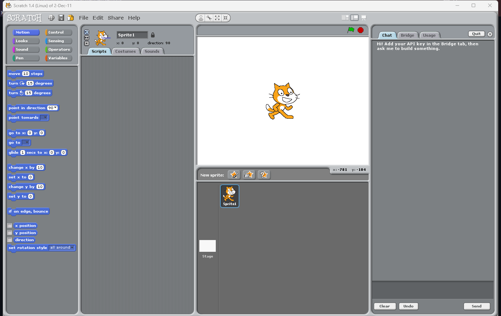

# Scratch AI Harness

I made this as a torment nexus for my friend who is doomerish about AI programming and is nostalgic about scratch 1.4. It is a chat harness that creates blocks from prompts and then allows for revising, undoing and running the project. It only uses scratch 1.4 assets with no image gen to keep the feeling that you are desecrating something sacred. 

this is a fork of [Scratch 1.4](https://github.com/scratchfoundation/Scratch_1.4)
(GPLv2). It is not affiliated with or endorsed by the Scratch Foundation (surprisingly)



## What it does

- A Chat / Bridge / Usage rail slapped on the right side of the real Scratch window, using the scratch UI design.
- The model replies with a JSON description of blocks (or a checked Python subset in `dsl` mode). Python checks it, compiles it into native Scratch block tuples, and Squeak builds `BlockMorph` stacks out of them.
- It can add, replace and delete scripts, variables, lists, sprites, costumes, backdrops and stage scripts.
- Every request carries the current project: sprites, scripts, ownership and media, with a few optional context packs that are the main thing im building and improving on now.
- The bridge also remembers the last 24 applied turns of the chat, so follow-ups like "make it smaller" resolve against what was just made. Turn it off with `run_live.ps1 -History off`.
- Undo reverts the last change set, without touching blocks you made.
- Sends run in the background, with a Stop button. There's token usage on the Usage page, and an opt-in audit log for figuring out why a model turn went wrong.

## Try the release build

If you just want to wade into this particular bastardisation of your childhood the [QUICKSTART](QUICKSTART.md) is. quicker.

### 1. Download

Get the latest `ScratchAIHarness-<version>.zip` from [GitHub Releases](https://github.com/MorganMaybe/scratch-ai-harness/releases)
(0.1.0 is about 50.6 MB). Or build it yourself; see [Development](#development).

The bundle contains:

```text
Scratch.exe + plugins        the Scratch 1.4 Squeak VM
ScratchAIRelease.image       clean, windowed, no dev tools
ScratchAiTesting.image       dev image with the 8767 control server
Media / Help / locale        stock Scratch 1.4 assets
bridge/                      local model bridge in python
tools/                       control, audit, media and image helpers
```

### The release image

`ScratchAIRelease.image` is the end-user version. It opens in a normal
1400×900 window with a title bar.

The release image has no 8767 control server, and no dev watchdog.

To close it, use the rail's Quit button, File -> Quit, or Alt+F4. The
Squeak Windows VM ignores the title-bar X, so don't rely on it.

### 2. Add your own API key

The image never contains a key. Store yours once:

```powershell
.\setup.ps1
```

`setup.ps1` installs the Python bridge dependencies and asks for your key. The key is masked and written to `bridge\.deepseek_key`, which is git-ignored. You can also set `DEEPSEEK_API_KEY` (or `OPENCODE_GO_API_KEY`) in the environment if you'd rather not have a file.

The default profile is `opencode-go` → `deepseek-v4.1-flash` (i am broke). The current limits are pretty arbitrary: hidden reasoning off, 120 seconds per attempt, 240 seconds per turn, 16,384 output tokens and an 80,000-character prompt budget. If you have a direct DeepSeek key, use `-Profile deepseek-direct`. For a local Ollama server, use `-Profile local`.

### 3. Run

```powershell
.\run_release.ps1
```

Then:

1. Click the Bridge tab in the right rail.
2. Click Start. The bridge listens on `127.0.0.1:8765`.
3. Go back to Chat, type a request, and press Send.

Honestly its pretty limited rn. like 8 year old levels of Scratch prowess. this will improve as i tune the context for Scratch. I’m aiming for at least 13 years old. 
It can do some cool 3d stuff if you give it a moment though so thats cool.

The blocks show up in the Scripts pane. Click the green flag to run them. If a change goes sideways, Undo in the rail reverts the last change set. Expect to go back and forth a bit; that's the job.

### Offline test (no key, no network)

```powershell
.\run_bridge.ps1      # deterministic mock bridge on 8765
```

The Chat rail then plays back canned scenes from `bridge/examples/`. This is
the quickest way to check that the image, the rail and the apply path all work
before you spend any tokens.

## Development

```powershell
git clone https://github.com/MorganMaybe/scratch-ai-harness.git
cd scratch-ai-harness
.\setup.ps1 -Dev
```

`-Dev` installs the bridge in editable mode along with pytest, and sets up
`bridge\harness.ini` from the example. See [CONTRIBUTING.md](CONTRIBUTING.md)
before you change anything.

### Runtime

`scratch\base` is git-ignored on purpose. It holds the Scratch VM, the media
and the images, and none of that belongs in the repo. You have two options:

- Use the release bundle. It already has the runtime and both images.
- Copy your own Scratch 1.4 runtime into `scratch\base`. See
  [`scratch/README.md`](scratch/README.md).

### Images


`ScratchAiTesting.image` dev image: control server on 8767, dev dialogs, Reload UI 
`ScratchAIRelease.image` end-user image: windowed, frame and rail fill the window, rail Quit button, no control server 
`ScratchDev.image` artifact from `tools\build_image.ps1` 

Rebuild the clean dev image while it's running:

```powershell
.\tools\make_clean_image.ps1
```

Rebuild the release image from the clean dev image:

```powershell
.\tools\make_release_image.ps1 -Force
```

`image\40_release_image.st` is where release mode lives. It is loaded last, and
it stores a flag that makes `AIHarness class>>startUp` skip the 8767 server and
the dev watchdog. It closes the Squeak tool windows and calls Scratch's
`fillScreenOn` with `TakeOverScreen` off. That's the native Scratch
mechanism for laying the frame out across the window. With takeover off, the
frame fills the normal window instead of the whole display. Release mode also
adds the release-only Quit button to the rail and keeps the chat rail and
the async dispatcher.

### Build the image from source

```powershell
# close the running image first (8767 must be free)
.\tools\build_image.ps1 -Seed ScratchAiTesting -Out ScratchDev -Force
.\run_scratch.ps1 -Image ScratchDev.image
```

### Drive the dev image headlessly

```powershell
python tools\ai_control.py status
python tools\ai_control.py send --async "make the hexagon bigger" --wait
python tools\ai_control.py undo
python tools\ai_control.py doctor
```

Ports: 8765 is the chat bridge. 8767 is the dev control server. Never expose 8767. [SECURITY.md](SECURITY.md) explains why, and it's worth reading before you run the dev image anywhere that isn't your own desk. No idea why you’d do that but i feel the need to warn people.

### Tests

```powershell
cd bridge
$env:PYTHONPATH="src"
python -m pytest -q

cd ..
python tools\check_st.py        # static check every image/*.st
```

The bridge tests generate a small media fixture when `scratch\base\Media` is
missing, so they run on a fresh clone and in CI. The live model tests are
opt-in:

```powershell
python -m pytest -q -m live
```

[TESTING.md](TESTING.md) covers the deterministic mock scene and the manual
release checklist.

## How it works

```text
Scratch image (Morphic)                     Python bridge (asyncio)
  chat rail / async worker   --8765-->   parse request + project context
  apply change set on UI     <--         validate -> repair -> compile -> literal
        |                                    |
        +-- undo / registry                  +-- model provider (OpenAI-compatible)
```

Every request carries a full project snapshot. The model never sees Python or Smalltalk. It emits a JSON block change set (or a Scratch-Python module in `dsl` mode — see below), and validation runs against the live project, so undo and manual edits get reconciled on the next turn.
DSL is trying to make it more like anything that deekseek has seen before. tuning the model for scratch only got so far, so now it writes in python and thats better (with like five asterisks, mostly that this abstraction from real scratch makes the whole "putting it in actual blocks" debarkle so much worse). alas we must persist with this approach otherwise it will always be making json that it barely understands what it does with. DSL it is.

There is a second reply format: with `generator = dsl` (in `bridge/harness.ini`
under `[harness]`, or `run_live.ps1 -Generator dsl`), the model answers in a
checked subset of Python instead of JSON — one fenced module where module-level
calls build the scene and one decorated `def` is one script. The bridge
transpiles that to the same block IR with line-precise diagnostics, so
`bad_json` and wrong-argument-name failures become parse-time rejections. The
appendix the model sees is [`SCRATCH_AI_DSL_CONTEXT.md`](SCRATCH_AI_DSL_CONTEXT.md)
and the design rationale is [`PY_DSL_SCOPE.md`](PY_DSL_SCOPE.md). JSON remains
the default until the live A/B ladder says otherwise.

Further reading, in roughly the order of insanity at interest:

- Design and protocol: [`ARCHITECTURE.md`](ARCHITECTURE.md)
- Where things stand right now: [`HANDOFF.md`](HANDOFF.md)
- Sprite and stage work: [`SPRITE_STAGE_SCOPE.md`](SPRITE_STAGE_SCOPE.md)
- Connection layer: [`DEEPSEEK_CONNECTION_SCOPE.md`](DEEPSEEK_CONNECTION_SCOPE.md)
- Chat rail: [`CHAT_UI_SCOPE.md`](CHAT_UI_SCOPE.md)
- Squeak traps: [`docs/SQUEAK_NOTES.md`](docs/SQUEAK_NOTES.md)
- Model appendix (JSON mode): [`SCRATCH_AI_CONTEXT.md`](SCRATCH_AI_CONTEXT.md)
- Model appendix (DSL mode): [`SCRATCH_AI_DSL_CONTEXT.md`](SCRATCH_AI_DSL_CONTEXT.md)

## Repository layout

```text
bridge/                  Python bridge: agent, providers, IR, validator, compiler, server, tests
image/                   Squeak-side harness and release-mode sources
context/                 lazy model context packs
tools/                   control client, audit, media index, image builders, .st checker
docs/                    Squeak notes, UI map, history, release screenshot
scratch/base/            local Scratch runtime (git-ignored)
setup.ps1                one-time Python + API-key setup
run_release.ps1          launch and size the windowed release image
run_live.ps1             launch the live bridge
run_bridge.ps1           launch the deterministic mock bridge
run_scratch.ps1          launch a dev image (control server)
```

## Known limitations

- User-created scripts are read-only. Editing them needs a confirmation flow
  that doesn't exist yet.
- Custom blocks, sound import and `.sprite` bundle import aren't exposed to the
  harness.
- The title-bar X in the release image doesn't close the app. Use Quit,
  File -> Quit or Alt+F4.
- The dev control server listens on all interfaces. See [SECURITY.md](SECURITY.md).
- This is a 2009 Squeak image with like tentacles coming out its chest. It works, but it has opinions about modal dialogues, and it doesn't like being pasted into with Ctrl+V.

## Licensing and trademarks

- The harness is released under GPLv2, matching the Scratch 1.4 source it
  modifies. See [`LICENSE`](LICENSE) and [`NOTICE`](NOTICE).
- Scratch, the Scratch logo, Scratch Cat and Gobo are trademarks of the Scratch
  Foundation. This project is an unofficial mod. See
  [`TRADEMARK_POLICY`](TRADEMARK_POLICY).
- The release bundle contains stock Scratch 1.4 media only. The Scratch 2.0
  sprite, costume and sound libraries I imported locally aren't redistributed,
  and the bundle builder excludes them. See [`NOTICE`](NOTICE).
- Your API key goes in `bridge\.deepseek_key` or the environment. Never put it
  in the image, a project, a log, a screenshot or a commit.

## Status

The end-to-end loop has been run live: chat → project context → bridge →
validate → apply real blocks → reply → undo. The Python suite has 852
passing tests on a fresh clone (854 with the local audit corpus), plus
2 opt-in live tests. CI runs on
Windows and Linux with Python 3.11 and 3.13, and it's green. The static `.st`
check runs there too.

For what's done, what's missing and what I'd do next, see
[`HANDOFF.md`](HANDOFF.md). Release history is in
[`RELEASE_NOTES.md`](RELEASE_NOTES.md).

## What's new in 0.2.0

- Scratch-Python front end: `generator = dsl` in `bridge\harness.ini` (or `run_live.ps1 -Generator dsl`). JSON is still the default.
- The bridge remembers the last 24 turns, so follow-ups like "make it smaller" resolve against the chat. Turn it off with `run_live.ps1 -History off`.
- Sloppy model replies are recovered mechanically, and repair prompts quote the bad line.
- 852 tests pass on a fresh clone.
- No new zip: `git pull` and keep the 0.1.0 runtime.
- Details in [`RELEASE_NOTES.md`](RELEASE_NOTES.md) and the current state in [`HANDOFF.md`](HANDOFF.md).

This is started out as spite now its turned into a whole thing and i think i need to curb my drinking problem. if that happens then this repo will get less active. what im saying is its my main personal project right now.
